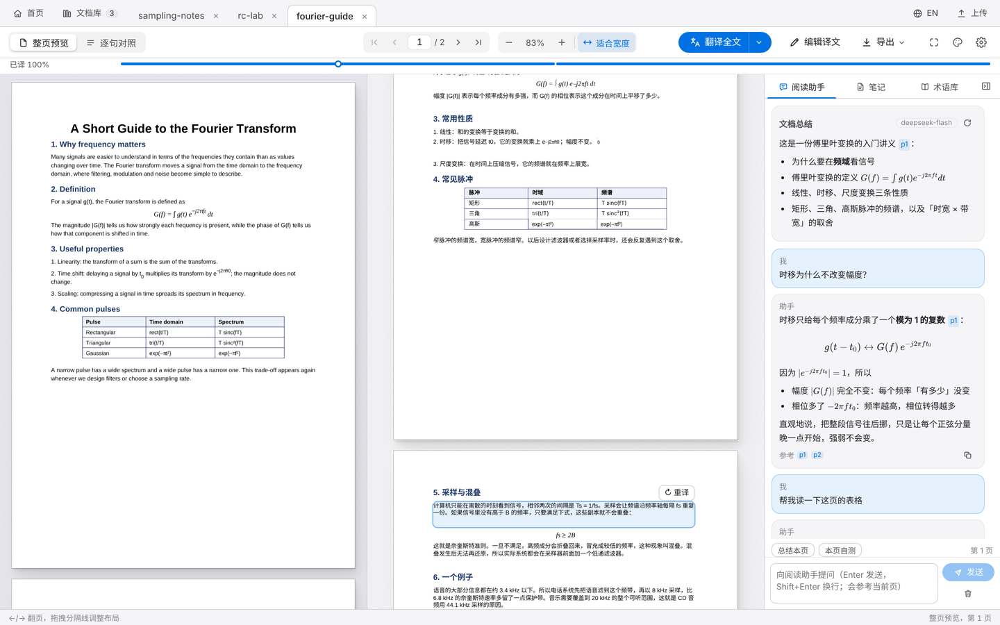
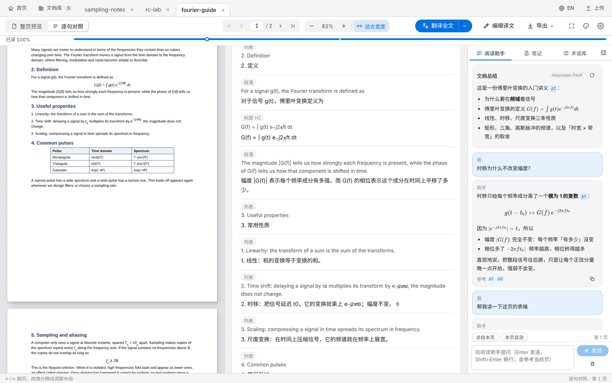
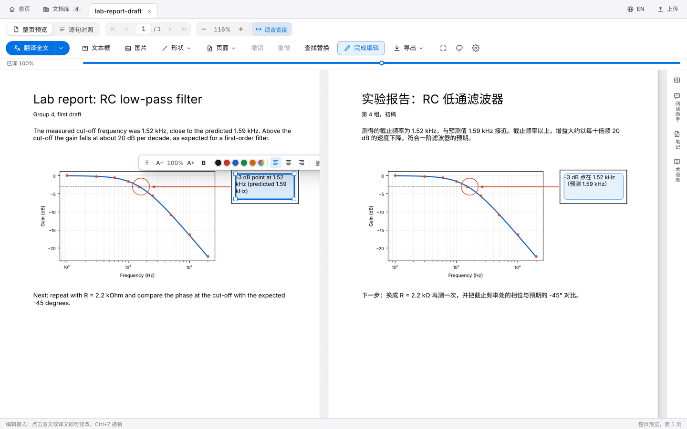
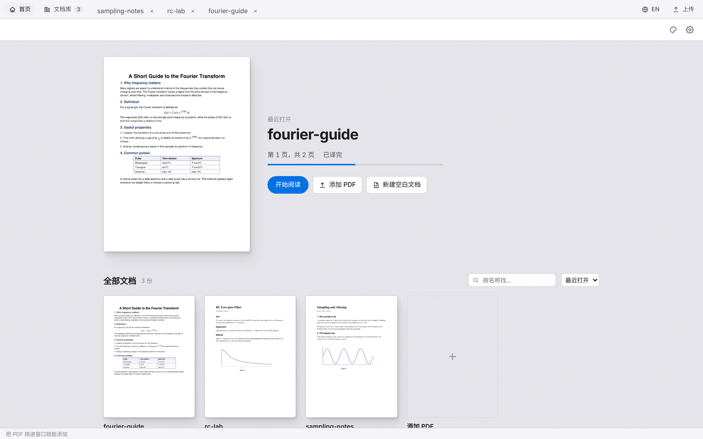
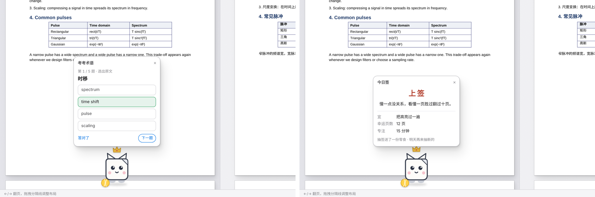

# PDF Bilingual Translation Reader

[简体中文](README.md) | **English** · [Homepage](https://114514ch-en.github.io/pdf-translate-reader/) · [Download for Windows](https://github.com/114514CH-EN/pdf-translate-reader/releases/latest)

A local PDF reader and translator: the original on the left, a translation laid out like the original on the right, with both panes scrolling together. Formulas, tables and images are kept as they are, which makes it suited to English papers, lab handouts and textbooks. Both sides can be edited, and you can also start from a blank page and write a PDF of your own.



Your documents, translations and notes stay on your own computer. Text is sent only to the LLM API you configure, and only when you translate or ask a question.

The interface can be switched between Chinese and English (EN in the tab strip); the desktop pet still speaks Chinese. The default translation direction is English → Chinese.

## Features

**Translation**
- Page view: the translation keeps the original's positions, font sizes and colours (headings, numbered-list indents and table cell alignment follow the source). A sentence-by-sentence view lets you edit each sentence
- Formulas are never re-typeset: inline and display math are cropped from the rendered page, so subscripts and superscripts match the original
- Text inside pictures can be translated too (Settings → Translation, off by default): text is recognised locally and painted back at the same place, size and colour
- Glossary (global and per document) that can be extracted from the document automatically; consistency polishing
- Estimates of tokens, cost and time before translating; a thin progress line along the top, one segment per page (click to jump)
- Export: translation-only PDF, side-by-side or alternating-page PDF, bilingual PDF, Markdown (with highlights and notes)



**Editing, and writing a PDF from scratch**
- Edit mode: click a paragraph to rewrite it; a format bar for size, bold, colour and alignment; drag to move, drag the corners to resize, hide a block; edit tables cell by cell; find and replace across the document; undo / redo (Ctrl+Z / Ctrl+Y)
- **The original is editable too**: in edit mode the left pane becomes the editable original; edits are used for later translations and can be exported as an "edited original" PDF
- **Formula editing**: click a display formula to rewrite it in LaTeX with a live preview and a row of common symbols; the original can be restored at any time
- **Add your own content**: text boxes, pictures (PNG / JPG / GIF / BMP / WebP) and shapes (line, arrow, rectangle, ellipse, with colour and thickness), placed where you click or drag
- **Pages**: add, move earlier / later, delete; a page organiser shows every page as a thumbnail to drag into order
- "New blank document" on the home page opens an empty A4 page in edit mode; export it as the edited original when you are done. Every change is carried into the exported PDFs



**Reading**
- Home page: the document you were reading in front, at the page you left it on, with the searchable, sortable library below and a preview when you rest the pointer on a document. The Home tab at the left of the tab strip is always there, and the open document keeps its place
- Select text to look it up in context, translate it, add it to the glossary, highlight it in five colours or write a note
- Ctrl+F searches the original and the translation at the same time; remembers where you stopped in each document
- Focus reading (F) hides every bar and leaves just the two pages
- 9 themes: default light / dark, e-ink (pages in greyscale or original colour), soft green, Swiss, glass, OLED, neo-brutalist, organic; in dark themes pages can be dimmed or inverted for night reading



**Reading assistant**
- Configured with its own model, separately from translation. It answers from the document and cites pages like `[p3]`, which you can click to jump to
- One click to "explain" a selected passage or "walk through" a formula; "summarise this page" and "quiz me on this page"
- Formulas in answers are rendered with KaTeX; supports DeepSeek V4 thinking mode, with the reasoning available to expand

**Desktop pet edition (小页)**
- A second interface for the same app: the reading assistant becomes a small pet that sits on the bottom edge of the window and opens a chat bubble when clicked. It wanders, can be dragged around, and pops up when you ask about selected text
- Change its look with an image URL (GIFs work) or a local file; backgrounds are removed on import, frame by frame for animations. Walking, thinking, talking, listening and sleeping can each have their own picture
- Physics: pick it up and it swings like a pendulum; fling it and it spins and tumbles; a hard landing leaves it seeing stars. Gravity can be Earth, Moon or feather (each effect can be turned off)
- It has moods and does things on its own (hops, spins, somersaults, stretches); rub the pointer over it and hearts come out
- Study companion: focus timer (15 / 25 / 45 minutes), pages read today, a seven-day chart, a daily goal ring and a streak; translation progress over its head
- **Play** (top of the right-click menu):
  - Treats and bond: reading a page, meeting the day's goal and finishing a focus round earn treats; feeding raises the bond through 6 levels, each unlocking a charm worn over its head (sprout, star, bow, crown, halo)
  - Ball: throw a ball around the window and it runs over to kick it back
  - Rock–paper–scissors, and a fortune for the day
  - Glossary quiz: five multiple-choice questions from the document's own glossary, with no AI calls
- After you stay on a page for a few seconds, it offers to explain the formulas, tables or long passages it sees there (can be turned off)
- The default look is 小页, a folded sheet of paper drawn for this project



**Other**
- Works with DeepSeek, OpenAI, Qwen, Kimi and any OpenAI-compatible endpoint (Ollama, LM Studio, self-hosted servers). Settings can fetch the model list so you can pick one
- Usage and cost tracking (by purpose and by document), with cache-hit pricing and peak / off-peak rates
- API keys are stored encrypted (Windows DPAPI); the database is backed up automatically on start-up; updates install from Settings

## Quick start (Windows)

### Option 1: download the exe (recommended, nothing to install)

1. From [Releases](https://github.com/114514CH-EN/pdf-translate-reader/releases/latest), download **`PDFTranslate-vX.Y.Z-windows.zip`** and extract it anywhere
2. Double-click **`PDFTranslate.exe`**; your browser opens `http://127.0.0.1:8765`. **`启动桌宠版.bat`** starts the desktop pet edition (after the first run a `PDFTranslate-Pet.exe` appears next to it). Later versions install from ⚙ Settings → Data & security → **Check for updates**
3. Open ⚙ Settings:
   - **翻译 (Translation)**: choose a provider, enter the API key, click "拉取模型列表" (fetch models) to pick a model, then "保存并测试" (save and test)
   - **阅读助手 (Reading assistant)**: configured separately (click "复制翻译 API 的配置" to start from the translation settings)
4. Drop a PDF into the window and click "翻译全文" (translate all). No document at hand? Try the sample [`docs/demo/fourier-guide.pdf`](docs/demo/fourier-guide.pdf)

Documents, translations and settings are stored in the `data\` folder next to the exe. To upgrade, download the new version and copy the old `data\` folder into it.

> With DeepSeek V4, thinking mode is turned off automatically for translation (faster and cheaper). For the reading assistant you can choose in Settings.

### Option 2: run from source

Requires **Python 3.10+**. The repository includes the built frontend, so **Node.js is not needed**. Download the source zip (or clone this repository) and double-click `run.bat`; for the pet edition double-click `run_pet.bat` (opens `http://127.0.0.1:8765/pet`). The first run creates a virtual environment and installs the dependencies. Both editions share the same backend and the same `data/` folder.

### Starting and closing

- To close it: close the console window, press Ctrl+C, or click "退出程序" (quit) in Settings → Data & security
- If an older version is still running when you start it, it is asked to quit first; if it cannot be stopped (for example it runs in another sandbox), the app starts on the next free port from 8766 instead

### Build the exe yourself

Run `build_exe.bat` (needs Python). It produces `dist\PDFTranslate\` with `PDFTranslate.exe` and `启动桌宠版.bat`; the whole folder can be copied elsewhere. Releases are built automatically on Windows by GitHub, see `.github/workflows/release.yml`.

### Server version (Vercel + your own server)

The app can also run as a website: the page on Vercel, the backend in Docker on your own server (reached through a Cloudflare Tunnel), with a login checked by an existing account service and limited to listed users. See [deploy/README.md](deploy/README.md) (Chinese).

## Where data is stored

| Location | Contents |
|---|---|
| `data/pdf_translate.db` | Document structure, translations, glossary, notes, highlights, usage records |
| `data/uploads/` | Uploaded PDFs and page caches |
| `data/backups/` | Automatic backups (latest 10) |
| `data/config.json` | Settings (API keys encrypted) |
| `data/pet/` | The desktop pet's imported image |

`data/` is excluded in `.gitignore` and is never committed.

## Development

```bash
# backend
python -m venv .venv && .venv\Scripts\pip install -r backend\requirements.txt
.venv\Scripts\python -m uvicorn backend.app.main:app --port 8765 --reload

# frontend (in a second terminal; the dev server proxies /api to 8765)
cd frontend && npm install && npm run dev      # http://localhost:5173 (pet edition: /pet.html)
npm run build                                  # writes frontend/dist

# tests (use a temporary data folder and never touch your library)
cd backend && ..\.venv\Scripts\python -m pytest -q tests
```

Stack: FastAPI + SQLite + PyMuPDF + Pillow (backend), React + TypeScript + Vite + Zustand + pdf.js + KaTeX (frontend). Development notes and design decisions are in [PROGRESS.md](PROGRESS.md) (Chinese).

Every document in the screenshots is demo content made for this project: `docs/demo/fourier-guide.pdf` is a sample handout, and the others were generated as examples.
