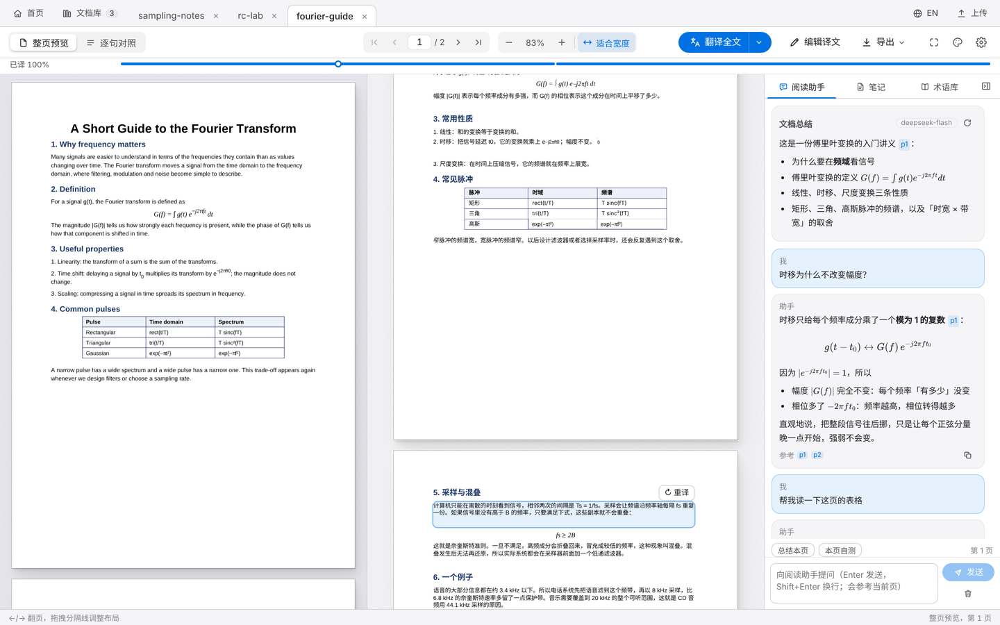
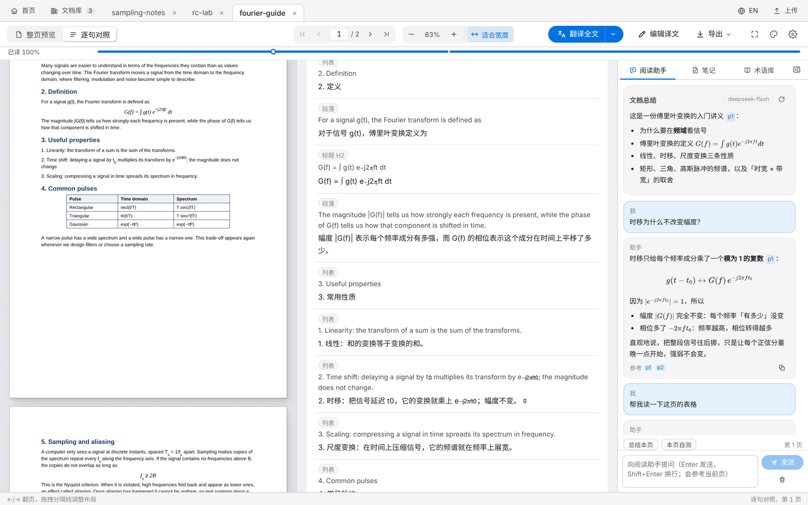
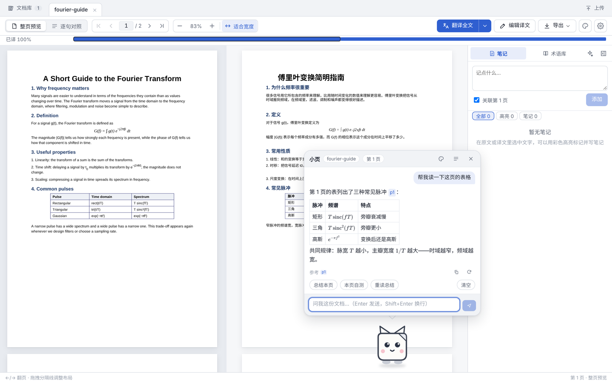

# PDF 双语翻译阅读器

**简体中文** | [English](README.en.md) · [项目主页](https://114514ch-en.github.io/pdf-translate-reader/) · [下载 Windows 版](https://github.com/114514CH-EN/pdf-translate-reader/releases/latest)

本地运行的 PDF 双语阅读与翻译工具：左边原文、右边保持原版式的译文，两栏同步滚动。公式、表格、图片按原样保留，适合读英文论文、实验手册和教材。



所有文档、译文和笔记都只保存在你自己的电脑上；只有在翻译 / 提问时，文字才会发给你配置的大模型 API。

## 功能

**翻译**
- 整页预览：译文按原 PDF 的位置、字号、颜色排版（标题、编号缩进、表格单元格对齐都跟原文一致）；逐句对照视图逐句编辑
- 公式不重排：行内公式和公式块直接截取原页渲染，下标、上标与原文一致
- 术语库（全局 + 文档级），可从文档自动抽取；一致性润色
- 翻译前估算 token、费用和时间；翻译进度条（每页一格，点击跳页）
- 导出：纯译文 PDF、左右对照 / 交替页 PDF、双语 PDF、Markdown（含高亮和笔记）



**阅读**
- 划词：选中文字即可查词（语境释义）、翻译、加入术语库、五色高亮、写笔记
- Ctrl+F 同时搜索原文和译文
- 记住每个文档的阅读位置
- 多标签页、文档库、8 种界面风格（含电子墨水 / 纸张）

**阅读助手**
- 独立配置自己的模型（与翻译分开）；基于文档内容回答并标注页码 `[p3]`，点击跳转
- 选中段落 / 公式一键「解释」「讲公式」；「总结本页」「本页自测」
- 回答中的公式用 KaTeX 渲染；支持 DeepSeek V4 思考模式并可展开查看思考过程

**桌宠版（小页）**
- 同一个程序的第二个界面：阅读助手变成趴在窗口下沿的桌宠「小页」，点一下弹出对话气泡；会走动、可拖动，划词提问时自动跑出来
- 形象可换：图片网址（gif 也行）或本地文件，导入时自动去背景（动图逐帧处理，保留动画）；走路 / 思考 / 说话 / 倾听 / 睡觉还能各配一张动作图
- 会按方向转身、闲着太久会睡着、你划词时竖起耳朵；气泡关着时答完了会跳一跳提醒
- 右键菜单：总结本页、自测、换装、安静模式、藏到角落（划词时才出来）
- 在一页停留一会儿，看到公式、表格或大段文字时会问你要不要讲讲（可关）
- 默认形象是为本项目画的「小页」：一张折了角的纸



**其他**
- 支持 DeepSeek、OpenAI、通义千问、Kimi，以及任何 OpenAI 兼容接口（Ollama、LM Studio、自建服务）；设置里可一键「拉取模型列表」
- 用量与费用统计（按用途 / 文档），支持缓存命中价和峰谷时段计价
- API Key 加密保存（Windows DPAPI）；启动时自动备份数据库

## 快速开始（Windows）

### 方式一：下载 exe（推荐，不用装任何东西）

1. 从 [Releases](https://github.com/114514CH-EN/pdf-translate-reader/releases/latest) 下载 **`PDFTranslate-vX.Y.Z-windows.zip`**，解压到任意位置
2. 双击 **`PDFTranslate.exe`**：浏览器会自动打开 `http://127.0.0.1:8765`；双击 **`PDFTranslate-Pet.exe`** 是桌宠版
3. 打开 ⚙ 设置：
   - **翻译**：选服务商、填 API Key、点「拉取模型列表」选模型，「保存并测试」
   - **阅读助手**：单独配置（可以点「复制翻译 API 的配置」作为起点）
4. 把 PDF 拖进窗口，点「翻译全文」。手边没有文档的话，可以先用仓库里的示例 [`docs/demo/fourier-guide.pdf`](docs/demo/fourier-guide.pdf) 试试

文档、译文和设置都存在 exe 旁边的 `data\` 文件夹里。升级时下载新版本，把旧文件夹里的 `data\` 复制过去即可。

> 使用 DeepSeek V4 时，翻译会自动关闭思考模式（更快、更省）。阅读助手可在设置里选择是否开启。

### 方式二：从源码运行

需要 **Python 3.10+**。仓库里已包含构建好的前端，**不需要 Node.js**。下载源码 zip（或克隆本仓库）后双击 `run.bat`；桌宠版双击 `run_pet.bat`（打开 `http://127.0.0.1:8765/pet`）。第一次运行会自动创建虚拟环境并安装依赖。两个版本共用同一个后端和同一份 `data/`，可以随时切换。

### 启动和关闭

- 关闭：关掉命令行窗口、按 Ctrl+C，或在「设置 → 数据与安全」里点「退出程序」
- 再次启动时如果旧版本还在运行，会先请它退出；实在关不掉（例如它在别的沙箱里），会自动改用 8766 起的空闲端口启动

### 自己打包 exe

运行 `build_exe.bat`（需要 Python），生成 `dist\PDFTranslate\`（含 `PDFTranslate.exe` 和 `PDFTranslate-Pet.exe`），整个文件夹可以复制到别处使用。发布新版本时 GitHub 会在 Windows 上自动打包，见 `.github/workflows/release.yml`。

## 数据存放

| 位置 | 内容 |
|---|---|
| `data/pdf_translate.db` | 文档结构、译文、术语、笔记、高亮、用量记录 |
| `data/uploads/` | 上传的 PDF 与页面缓存 |
| `data/backups/` | 自动备份（最近 10 份） |
| `data/config.json` | 设置（API Key 已加密） |
| `data/pet/` | 桌宠形象（导入的图片） |

`data/` 已在 `.gitignore` 中排除，不会被提交。

## 开发

```bash
# 后端
python -m venv .venv && .venv\Scripts\pip install -r backend\requirements.txt
.venv\Scripts\python -m uvicorn backend.app.main:app --port 8765 --reload

# 前端（另开一个终端，开发服务器把 /api 代理到 8765）
cd frontend && npm install && npm run dev      # http://localhost:5173（桌宠版：/pet.html）
npm run build                                  # 生成 frontend/dist

# 测试（使用临时数据目录，不会碰到你的文档库）
cd backend && ..\.venv\Scripts\python -m pytest -q tests
```

技术栈：FastAPI + SQLite + PyMuPDF + Pillow（后端），React + TypeScript + Vite + Zustand + pdf.js + KaTeX（前端）。开发进度与设计说明见 [PROGRESS.md](PROGRESS.md)。

截图里的示例文档 `docs/demo/fourier-guide.pdf` 是为本项目写的演示讲义。
